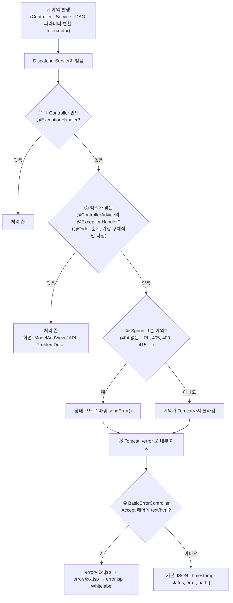

# M8. 예외 처리 다시 보기 — 학습 교안 (맛집 노트 버전)

> 원본 교안: Notion **[Spring MVC pt.2] Part 3 예외 처리 (13~19장)**, **[REST API] 12~14장**
> 참고 샘플: `FW_05_mvc_basic_sol`·`FW_10_rest_sol`의 `MvcExceptionHandler`·`RestExceptionHandler`·`RecordNotFoundException` (정답이므로 막혔을 때 **구조만** 참고)
> 이 문서는 원본 교안의 흐름을 **맛집 노트 코드에 맞춰** 다시 묶은 실습 안내서다. 완성 코드는 없다. 무엇을, 왜, 어디에 쓰는지만 있다.

---

## 0. 왜 다시 하나

- M5(화면 예외)와 M7(API 예외)는 시간이 빠듯해서 **튜터가 대부분 써 줬다.** M5 셀프 체크 질문 대부분에 "모르겠어"라고 답했다.
- 이번에는 Advice를 **일부러 비워 두고** 시작한다. "Advice가 없으면 무슨 일이 생기는지"를 먼저 보고, **직접** 채운다.
- 덤으로 지금 코드에 남아 있는 문제 3개를 같이 고친다.
  1. `ReviewController`에 **같은 모양의 try-catch가 반복**된다. 교안 13장의 "코드 중복" 문제다.
  2. "없는 리뷰"를 `IllegalArgumentException`으로 던진다. 그런데 이 예외는 "입력이 잘못됨"이라는 뜻이고, 중복 이메일·이미지 아닌 파일도 같은 타입이다 (8-4).
  3. M5 ⏭️에 남겨 둔 "수정 폼·저장의 Forbidden catch 정리" (8-5)

---

## 1. 튜터가 세팅해 둔 것 (2026-11-24)

| 파일 | 바뀐 점 |
|---|---|
| `config/MvcExceptionHandler.java` | 내용을 비우고 **애너테이션도 뗐다** → 지금은 Advice가 아니다. `// TODO: 8-3-x` 주석만 있다 |
| `config/RestExceptionHandler.java` | 위와 같다. `// TODO: 8-6-x` |
| `model/service/ReviewServiceImpl.java` | "찾을 수 없는 리뷰" 두 곳에 `// TODO: 8-4-2` 주석 (코드는 그대로) |
| `controller/ReviewController.java` | 맨 위에 `// TODO: 8-5` 주석 (코드는 그대로) |
| `ReviewControllerTest.java` | 목표 테스트 ③④ 추가, ⑤는 TODO (교육생 작성) |
| `ReviewRestControllerTest.java` | 목표 테스트 ⑤⑥ 추가, ⑦은 TODO (교육생 작성) |

**지금 테스트 상태** (`ReviewControllerTest`, `ReviewRestControllerTest`를 `Run As > JUnit Test`):

| 테스트 | 지금 | 언제 초록이 되나 |
|---|---|---|
| MVC ① 남의 리뷰 삭제 → 403 | 🔴 | 8-3 |
| MVC ② 비로그인 작성 → 로그인 화면 | 🟢 | (Interceptor 담당, 그대로) |
| MVC ③ 예상 못 한 오류 → 500, 내부 정보 숨김 | 🔴 | 8-3 |
| MVC ④ 남의 리뷰 수정 폼 → 403 | 🔴 | 8-5 |
| MVC ⑤ 없는 리뷰 → 404 | ✍️ 직접 작성 | 8-4 |
| REST ① 상세 200 / ③ 작성 201 / ④ 비로그인 401 | 🟢 | (그대로) |
| REST ② 없는 리뷰 → 404 | 🔴 | 8-4 + 8-6 |
| REST ⑤ 예상 못 한 오류 → 500, 내부 정보 숨김 | 🔴 | 8-6 |
| REST ⑥ form 형식으로 작성 → 415 | 🔴 | 8-6 |
| REST ⑦ 남의 글 → 403 | ✍️ 직접 작성 | 8-6 |

> ⚠️ **테스트는 요구사항이다.** 빨간 불을 끄려고 테스트를 고치지 않는다. 메인 코드를 고친다. (예외: REST ②는 8-4에서 가짜 Service가 던지는 예외 타입을 바꿔야 한다. 요구사항 자체가 바뀌기 때문이다.)

빨간 테스트의 Console을 보면 두 가지 모양이 있다.
- `Status expected:<403> but was:<302>` → 응답은 왔는데 **기대와 다르다** (Failure)
- `ServletException: Request processing failed` → **아무도 예외를 처리하지 않아서** 테스트 밖까지 터졌다 (Error). MockMvc에는 Tomcat이 없어서 `/error`로 가지 않는다 → 2장 그림의 "Tomcat" 단계가 테스트에서는 없다는 뜻이다.

---

## 2. 큰 그림: 예외가 나면 어디로 가나

- **우선순위**: Controller 안 `@ExceptionHandler` → `@ControllerAdvice` → BasicErrorController (교안 16장 마지막 토글 표)
- **Advice가 할 수 있고 BasicErrorController는 못 하는 것**: 예외별 **로그**, 예외별 **맞춤 메시지·상태 코드** (교안 15장 "부족해요" 박스)
- **범위를 정한 Advice**(`basePackages` 등)는 **그 Controller가 선택된 뒤** 난 예외만 받는다. 없는 URL(404)·405는 Controller가 선택되기 전에 실패 → ③ → ④로 간다 (교안 17장)
- ③에서 처리되는 예외도 **우리 Controller가 선택된 뒤에 났다면** ②가 먼저 가로챌 수 있다 → 8-3 실험, 8-6 ⑥번 테스트에서 직접 본다

---

## 3. 맛집 노트 예외 지도

| 예외 | 어디서 던지나 | 뜻 | 사용자가 그 자리에서 고칠 수 있나? |
|---|---|---|---|
| `IllegalArgumentException` "이미 가입된 이메일" | `MemberServiceImpl.signUp` | 입력 오류 | ⭕ (다른 이메일로) |
| `IllegalArgumentException` "이메일 또는 비밀번호가 틀렸습니다" | `MemberServiceImpl.login` | 입력 오류 | ⭕ |
| `InvalidImageException` (IAE의 자식) | `LocalImageStorage.save` | 입력 오류 | ⭕ (다른 파일로) |
| `IllegalArgumentException` "찾을 수 없는 리뷰" → **8-4에서 `RecordNotFoundException`으로** | `ReviewServiceImpl` 2곳 | 대상 없음 | ❌ |
| `ForbiddenException` | `ReviewServiceImpl.checkReviewMno` | 권한 없음 | ❌ |
| `UncheckedIOException` | `LocalImageStorage.save` | 서버 디스크 문제 | 🤔 (8-5에서 직접 정하기) |
| 그 밖 (`DataAccessException`, NPE …) | 어디서든 | 예상 못 한 오류 | ❌ |
| Spring 표준 예외 (없는 URL, 405, 타입 변환 실패, 415 …) | Spring 내부 | 요청 자체가 틀림 | — |

→ 이 표의 마지막 열이 8-5의 판단 기준이 된다.

---

## 4. 실습 단계

### 8-1. 👀 + 🔍 관찰: Advice가 없으면? (교안 13·15·17·18장) · 20분

앱을 `Run As > Spring Boot App`으로 띄우고 아래 표를 채운다. **"예상" 칸을 먼저 쓰고** 해 본다. 표는 `STUDY_LOG.md`에 옮겨 두면 8-7에서 비교할 수 있다.

| # | 요청 | 예상 (상태 코드·화면) | 실제 | 누가 처리? |
|---|---|---|---|---|
| 1 | 로그인 → **남의 리뷰** 상세에서 삭제 | | | |
| 2 | `/review/9999` | | | |
| 3 | `/review/abc` | | | |
| 4 | `/nope` | | | |
| 5 | 주소창에 `/review/1/delete` (GET) | | | |
| 6 | 브라우저 주소창에 `/api/review/9999` | | | |
| 7 | 터미널에서 `curl -i http://localhost:8080/api/review/9999` | | | |

확인할 것
- 1번에서 화면에 보이는 문구와 STS Console 로그. 우리 로그(`log.warn` 등)가 있나? 누가 찍은 로그인가?
- 6번과 7번은 **같은 주소**인데 응답 모양이 다르다 → 왜? (교안 18장 "HTML 요청과 AJAX 요청 분리")
- 5번은 Whitelabel이 나온다 → 우리 에러 JSP가 있는데 왜 못 골랐을까? (교안 15장 페이지 고르는 순서)

### 8-2. 🔍 BasicErrorController 활용 (교안 15·18장) · 20분

- [ ] 8-1의 5번(405)·3번(400)을 위한 **공통 4xx 페이지** `views/error/4xx.jsp` 만들기 (`500.jsp`를 복사해서 시작). BasicErrorController가 넣어 주는 값(`status`, `error`, `path`)을 출력 → 5번을 다시 요청해서 확인
- [ ] 실험: `application.properties`에 `server.error.include-message=always`를 잠깐 넣고 8-1의 7번 다시 → JSON에 무엇이 늘었나? → **실험 후 반드시 지우기.** 왜 기본값이 `never`일까?
- [ ] 👀 (선택) `DefaultErrorAttributes`를 상속해 공통 값 추가하기 (교안 18장 마지막). 화면과 JSON **양쪽**에 동시에 반영된다

### 8-3. 🔍 화면용 Advice 다시 쓰기: `MvcExceptionHandler` (교안 16·17장) · 30분

`config/MvcExceptionHandler.java`의 `TODO: 8-3-x`를 채운다.

| TODO | 요구사항 | 힌트 (이름 수준) |
|---|---|---|
| 8-3-1 | controller 패키지만 담당하는 Advice | `@ControllerAdvice`의 `basePackages`, `@Slf4j` |
| 8-3-2 | `ForbiddenException` → 403 + `error/403` + `msg` | `@ExceptionHandler`, `@ResponseStatus`, `ModelAndView` (왜 `Model`이 아닐까? 교안 16장 토글) |
| 8-3-3 | 나머지 전부 → 500 + `error/500` + 고정 문구 | 로그는 예외 객체째 넘겨야 스택 트레이스가 찍힌다 |
| 8-3-4 | 실험: 상태 코드 지정을 빼면? | 테스트 ①의 실패 메시지를 읽기 → 다시 넣기 |

확인
- [ ] MVC 테스트 ①③ 🟢
- [ ] 8-1의 1번을 브라우저로 다시 → 403 화면 + Console에 **우리** warn 로그
- [ ] 🧪 생각해 보기: 이제 `/review/abc`(8-1의 3번)는 몇 번이 나올까? 해 보고 이유를 2장 그림의 ②·③으로 설명하기. 400이 맞다고 생각하면 어떻게 고칠 수 있을까? (선택 과제: 예외 클래스 이름은 Console 로그에서 찾기)

### 8-4. 🔍 커스텀 예외 `RecordNotFoundException` (교안 16장 "예외 종류별로" 토글) · 30분

**먼저 생각해 보기**: M7의 `RestExceptionHandler`는 `IllegalArgumentException`을 404로 바꿨다. 그럼 API에서 `InvalidImageException`이나 "이미 가입된 이메일"이 터지면 몇 번이 나갔을까? (3장 표의 상속 관계를 보기)

| TODO | 요구사항 | 힌트 |
|---|---|---|
| 8-4-1 | `exception/RecordNotFoundException` 만들기 | `ForbiddenException`과 같은 모양. **무엇을 상속할지**가 핵심 → `IllegalArgumentException`을 상속하면 안 되는 이유를 말할 수 있어야 한다 |
| 8-4-2 | `ReviewServiceImpl` 2곳을 새 예외로 | `throw` 한 줄씩 |
| 8-4-3 | `MvcExceptionHandler`에 404 처리 추가 | 8-3-2와 같은 모양, 상태 코드·View만 다르다 |
| 8-4-4 | MVC 테스트 ⑤ 작성 | 테스트 ①과 같은 Given-When-Then. 이번에는 값을 반환하는 메서드라 `when().thenThrow()` |
| 8-4-5 | REST 테스트 ②의 가짜 Service가 새 예외를 던지게 수정 | 테스트가 표현하는 "요구사항"이 바뀌었으므로 이번만 테스트를 고친다 |
| 8-4-6 | `error/404.jsp`가 Advice가 넘긴 `msg`도 보여 주게 | 지금은 BasicErrorController의 `path`만 출력한다 → `msg`가 있으면 `msg`, 없으면 지금처럼 (`<c:choose>`) |

⚠️ 8-4-2를 하면 **`ReviewController`의 `catch (IllegalArgumentException e)`들이 더 이상 "없는 리뷰"를 잡지 않는다.** 화면 동작이 바뀐다 → 바로 8-5로 간다.

### 8-5. 🔍 Controller의 try-catch 정리 (교안 13장 "코드 중복") · 30분

`ReviewController`의 catch를 하나씩 보고 **남길지 / 지우고 Advice에 맡길지** 정한다.

**판단 기준**

| 사용자가 그 자리에서 고칠 수 있나? | 처리 위치 | 이유 |
|---|---|---|
| ⭕ (폼 입력 오류) | **Controller catch** → 폼으로 돌아가 메시지 | 사용자는 입력을 고쳐 다시 보내면 된다. 에러 화면으로 보내면 쓴 내용을 잃는다 |
| ❌ (없음, 권한 없음, 예상 못 한 오류) | **Advice** → 에러 화면 + 정확한 상태 코드 | 모든 Controller에서 같은 처리 → 한 곳에 모은다 |

- [ ] 메서드별로 catch 목록을 만들고 각각 "남김/삭제 + 이유"를 `STUDY_LOG.md`에 한 줄씩 쓴다. **판단을 먼저 쓰고** 코드를 고친다
- [ ] `ForbiddenException` catch 2곳(`editForm`, `editReview`) → M5 셀프 체크 Q1("Advice가 있으면 이 catch는?")의 답을 직접 확인
- [ ] `UncheckedIOException`(사진 저장 실패)은 어느 쪽인가? 정답은 없다. 정하고 이유를 쓴다
- [ ] 다 지운 뒤 쓰이지 않는 import, `detail.jsp`의 `error` 분기가 남는지 확인 (💅)
- [ ] MVC 테스트 ④ 🟢, 전체 MVC 테스트 🟢
- [ ] 브라우저: 8-1의 1·2번 + 남의 리뷰 수정 주소 직접 입력 → 403 화면

### 8-6. 🔍 API용 Advice 다시 쓰기: `RestExceptionHandler` (REST 교안 12~14장) · 40분

`config/RestExceptionHandler.java`의 `TODO: 8-6-x`를 채운다.

| TODO | 요구사항 | 힌트 |
|---|---|---|
| 8-6-1 | restcontroller 패키지 담당 + JSON 응답 + 화면용보다 먼저 | `@RestControllerAdvice`의 `basePackageClasses`, `@Order`, `Ordered` (교안 13·14장) |
| 8-6-2 | `RecordNotFoundException` → 404 | `ProblemDetail.forStatusAndDetail(...)`. 상태 코드를 담으면 `@ResponseStatus`는 필요 없다 (왜?) |
| 8-6-3 | `ForbiddenException` → 403 + 테스트 ⑦ 작성 | ⑦은 테스트 ②를 본떠서 |
| 8-6-5 | 나머지 전부 → 500, detail은 고정 문구 | 교안 14장 ⚠️: 예시 응답의 detail에 SQL이 그대로 나간 것을 보기 |
| 8-6-4 | Content-Type 불일치 → 415 | **순서대로 해 보기**: 8-6-5까지 만든 상태에서 테스트 ⑥을 돌린다 → 몇 번이 나오나? → `print()` 결과의 `Resolved Exception` 줄에서 예외 클래스 이름을 찾는다 → 그 예외를 위한 핸들러를 추가한다 |
| 8-6-6 | (선택) `code` 필드 추가 | `ProblemDetail`의 `setProperty` (교안 14장 "한 발 더") |
| (선택) | 깨진 JSON(`{"title": `처럼 끝이 잘린 본문) → 400 | M7 기록에 남긴 숙제. 테스트를 직접 써서 지금 몇 번인지 먼저 확인 → 8-6-4와 같은 방법으로 해결 |

확인
- [ ] REST 테스트 ②⑤⑥⑦ 🟢
- [ ] 8-1의 6·7번 다시 → 이제는 둘 다 같은 모양(JSON)일까? 이유는? (힌트: 이제 누가 처리하나)
- [ ] 👀 테스트 ⑥ 실험에서 본 것이 교안 12장 "어색한 점 찾기"와 같은 현상이다. 그때는 **화면용** Advice가, 이번에는 **우리** Exception 핸들러가 Spring 표준 예외를 가로챘다
- [ ] 👀 (범위 밖, 이름만) Spring 표준 예외를 한꺼번에 ProblemDetail로 바꿔 주는 `ResponseEntityExceptionHandler`라는 부모 클래스가 있다

### 8-7. 👀 정리 · 15분

- [ ] 8-1 표를 다시 채워 **전/후 비교**
- [ ] 예전(M5·M7) 코드와 비교 (**다 쓴 뒤에만**): STS `Team > Show History` 또는 터미널 `git show bc16023:MatzipNote/src/main/java/com/study/matzip/config/MvcExceptionHandler.java`. 무엇이 같고 무엇이 달라졌나? 이번에 새로 생긴 핸들러는?
- [ ] Advice가 **잡는** 예외 vs **못 잡는** 예외 정리

| 예외가 난 곳 | Advice가 잡나? | 이유 |
|---|---|---|
| Controller · Service · DAO | ⭕ | Controller 메서드를 거쳐 DispatcherServlet으로 올라온다 |
| 파라미터 변환 (`/review/abc`) | ⭕ (범위가 맞으면) | Controller가 이미 선택된 뒤 |
| Interceptor `preHandle` | ⭕ | DispatcherServlet **안**에서 호출된다 (M6) |
| 없는 URL(404), 405 | ❌ (범위를 정한 Advice는) | Controller가 선택되기 전 |
| **Filter** (Tomcat 단계) | ❌ | DispatcherServlet **밖** → M13 JWT의 `SecurityExceptionHandlingFilter`가 이 문제를 푼다 |

- 다음 마일스톤 연결: M9 Interceptor 심화의 `afterCompletion(…, ex)`에서 **Advice가 처리한 예외는 `ex`로 보일까?** (교안 Interceptor 셀프 체크 Q4)

---

## 5. 자주 하는 실수

1. **상태 코드를 안 정함** → 에러 화면인데 **200 OK** (8-3-4에서 직접 봄)
2. **범위 없는 `Exception` 핸들러** → 404·405까지 잡아 **500**으로 만든다 (교안 17장 ⚠️)
3. **`e.getMessage()`를 그대로 화면·JSON에** → SQL·테이블 이름 노출 (테스트 ③⑤가 잡는다)
4. **부모 타입에 매핑** → 자식 예외까지 같은 상태 코드 (`IllegalArgumentException` → 404 문제, 8-4)
5. **`Exception` 핸들러가 Spring 표준 예외를 삼킴** → 415·400이 500으로 (8-6 ⑥)
6. **catch 순서**: 자식 타입을 먼저 (`InvalidImageException`이 `IllegalArgumentException`보다 위). Advice는 "가장 가까운 타입"을 알아서 고르지만, **try-catch는 위에서부터** 본다
7. **flash 속성은 redirect일 때만** 다음 요청에 전달된다 → Advice에서 View를 바로 보여 줄 때는 `ModelAndView`에 담는다

---

## 6. 셀프 체크 (답은 STUDY_LOG 🙋에 쓰고 튜터에게 확인받기)

교안 원문 문제 (MVC pt.2 Part 3 셀프 퀴즈)
1. Spring Boot에서 web.xml 없이 에러 페이지를 연결해 주는 것은? 에러는 어떻게 거기까지 가나?
2. `error/404.jsp`와 `error.jsp`만 있을 때 404·405·500은 각각 어떤 페이지가 보일까?
3. `server.error.include-exception` 같은 설정을 운영에서 켜면 안 되는 이유는?
4. BasicErrorController만으로 부족한 점과 해결책은?
5. `@ExceptionHandler` 메서드에 상태 코드를 안 정하면?
6. `Exception` 핸들러와 `RecordNotFoundException` 핸들러가 둘 다 있을 때 `RecordNotFoundException`이 터지면?
7. 범위를 controller 패키지로 정한 Advice는 `GET /nope`(404)를 처리할까? 이유는?
8. 같은 `/error`인데 브라우저는 HTML, curl은 JSON을 받는 이유는?

M5·M7에서 "모르겠어"였던 문제 다시
9. Advice에 `ForbiddenException` 핸들러를 만들면 Controller의 Forbidden catch는? (8-5에서 직접 해 봤다)
10. 화면용 `@ControllerAdvice`와 API용 `@RestControllerAdvice`를 왜 나눌까? 하나로 합치면 무엇이 문제일까?
11. `basePackageClasses = ReviewRestController.class`는 `ReviewRestController` **하나만** 담당할까?

맛집 노트 문제
12. `RecordNotFoundException`은 왜 `IllegalArgumentException`이 아니라 `RuntimeException`을 상속했나?
13. "이미 가입된 이메일"은 왜 Advice가 아니라 `MemberController`에서 catch하는 게 맞을까?
14. 테스트 ⑥에서 `Exception` 핸들러만 있을 때 415가 500으로 바뀐 이유를 2장 그림의 번호로 설명하기

---

## ✅ 완료 기준

- [ ] 전체 테스트 초록 (튜터가 넣은 목표 테스트 + 교육생이 쓴 ⑤·⑦ 포함)
- [ ] 브라우저 전/후 비교 표 (8-1 → 8-7)
- [ ] `ReviewController` catch 정리 판단 기록 (8-5)
- [ ] 셀프 체크 14문제 답 작성
